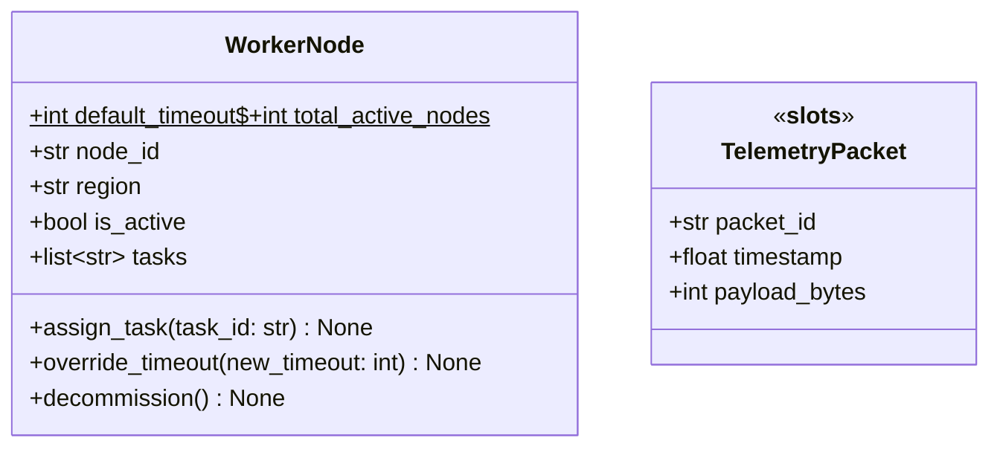
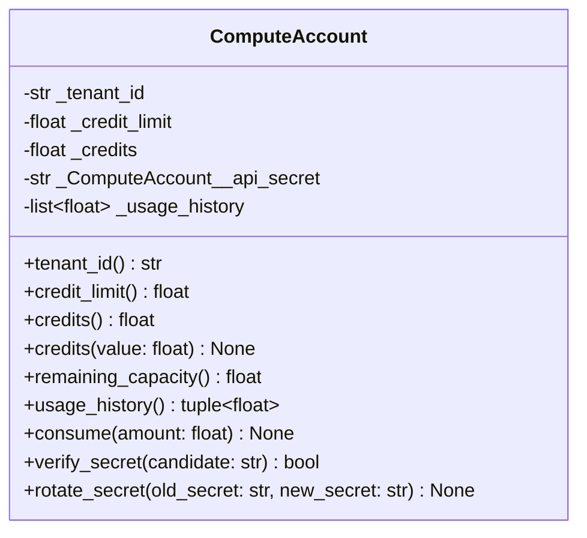
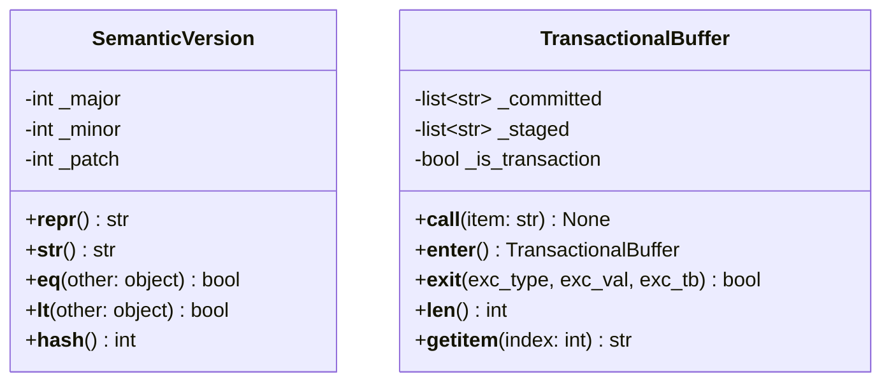

# Phase 1: Pythonic OOP Fundamentals

## Lesson 1.1: Classes, CPython Memory Model & Attributes

- **`__new__` vs. `__init__`:** `__new__` allocates the `PyObject` in C heap memory; `__init__` initializes attributes on `self` and returns `None`.
- **Attribute Lookup Order:**
  1. Data Descriptors on `Class.__dict__` (e.g., `@property` with setter, `__slots__`)
  2. Instance state on `self.__dict__`
  3. Non-data descriptors & class attributes on `Class.__dict__` (and up the MRO)
- **Mutable Class Attribute Trap:** Never put `list`/`dict`/`set` on the class body unless intended as global shared state. Initialize per-instance collections in `__init__`.
- **Shadowing Trap:** `self.count += 1` reads from `Class.__dict__` and writes to `self.__dict__`. Mutate class state via `type(self).count += 1`.
- **`__slots__`:** Replaces the dynamic `self.__dict__` hash table with a fixed-size C pointer array. Saves 40–60% RAM and blocks accidental attribute typos.

## Lesson 1.2: Encapsulation, Name Mangling & `@property`

- **Pythonic Encapsulation:** Never write Java-style `get_x()` / `set_x()`. Expose public attributes first, and upgrade to `@property` descriptors when validation or computed state is needed without breaking caller interfaces.
- **Data Descriptor Priority:** `@property` with a `@x.setter` is a Data Descriptor living in `Class.__dict__`. It intercepts attribute reads and writes _before_ `self.__dict__`.
- **Validation in `__init__`:** Assigning `self.credits = initial_credits` inside `__init__` automatically invokes `@credits.setter`, avoiding duplicated validation logic.
- **`_protected` vs. `__private`:**
  - `_attr`: Convention-only internal attribute (enforced by linters/type-checkers, no runtime changes).
  - `__attr`: Compile-time name mangling to `_ClassName__attr` inside `self.__dict__` to prevent accidental attribute collisions in subclasses.
- **Defensive Copying:** Never return a direct reference to a mutable internal collection (`list`, `dict`, `set`) from a read-only property. Return `tuple(self._items)` or a shallow/deep copy.

## Lesson 1.3: Python Data Model & Dunder Methods

- **C-Level Type Slots:** Dunder methods (`__len__`, `__eq__`, `__getitem__`, `__call__`) bind directly to fixed C function pointer slots on `PyTypeObject`, making built-in operations like `len(x)` or `x == y` fast $O(1)$ C-slot dispatches.
- **`__repr__` vs. `__str__`:** `__repr__` is for unambiguous developer debugging (`ClassName(a=1)`); `__str__` is for clean display (`v1.0.0`). Always implement `__repr__`.
- **Equality & Ordering Contract:**
  - Type annotate `other: object` in `__eq__` and `__lt__` to satisfy Liskov Substitution (`mypy --strict`).
  - Return the singleton `NotImplemented` (do NOT raise `NotImplementedError`) when `other` is an incompatible type.
  - Use `@functools.total_ordering` alongside `__eq__` and `__lt__` to auto-generate `<=`, `>`, and `>=`.
- **Hashability Rule:** Defining `__eq__` sets `__hash__ = None` by default. To use an object in a `set` or `dict` key, make its attributes read-only and implement `__hash__` over a tuple of those attributes.
- **Context Managers (`with`):** `__enter__` prepares state and returns the resource. `__exit__(exc_type, exc_val, exc_tb)` handles teardown/rollback and returns `False` so exceptions propagate naturally (`True` silently swallows exceptions!).

