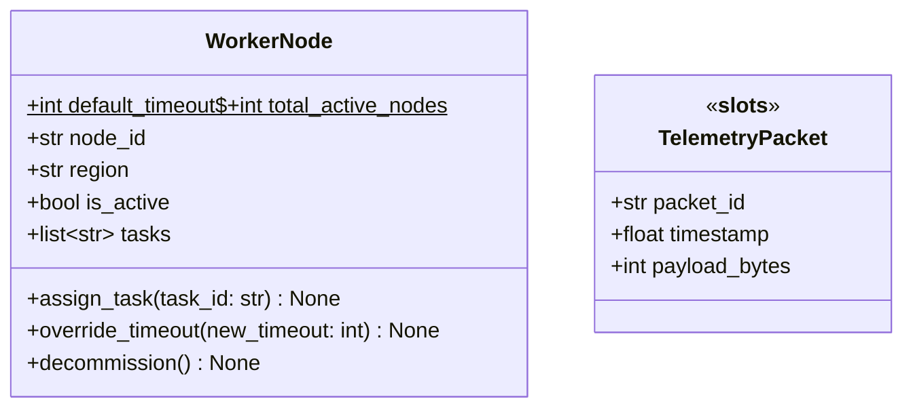

# Phase 1: Pythonic OOP Fundamentals

## Lesson 1.1: Classes, CPython Memory Model & Attributes
- **`__new__` vs. `__init__`:** `__new__` allocates the `PyObject` in C heap memory; `__init__` initializes attributes on `self` and returns `None`.
- **Attribute Lookup Order:**
  1. Data Descriptors on `Class.__dict__` (e.g., `@property` with setter, `__slots__`)
  2. Instance state on `self.__dict__`
  3. Non-data descriptors & class attributes on `Class.__dict__` (and up the MRO)
- **Mutable Class Attribute Trap:** Never put `list`/`dict`/`set` on the class body unless intended as global shared state. Initialize per-instance collections in `__init__`.
- **Shadowing Trap:** `self.count += 1` reads from `Class.__dict__` and writes to `self.__dict__`. Mutate class state via `type(self).count += 1`.
- **`__slots__`:** Replaces the dynamic `self.__dict__` hash table with a fixed-size C pointer array. Saves 40–60% RAM and blocks accidental attribute typos.

